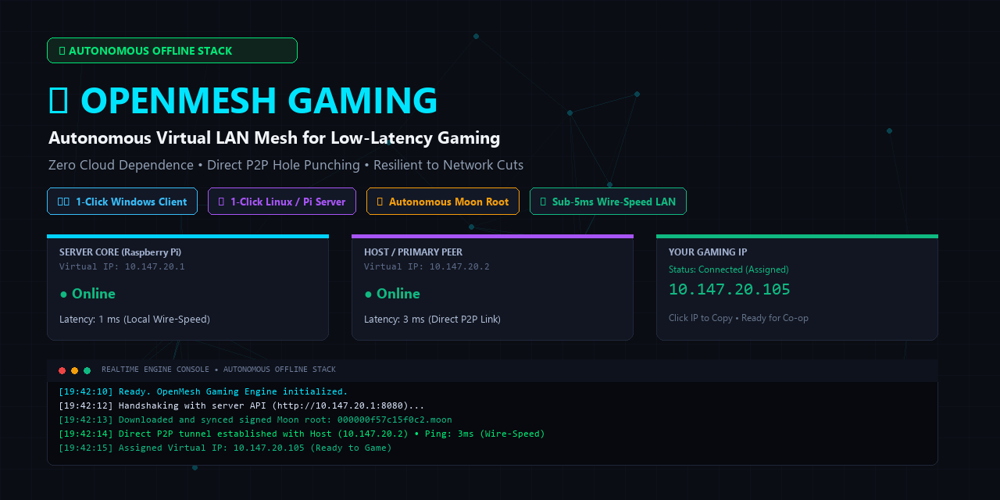
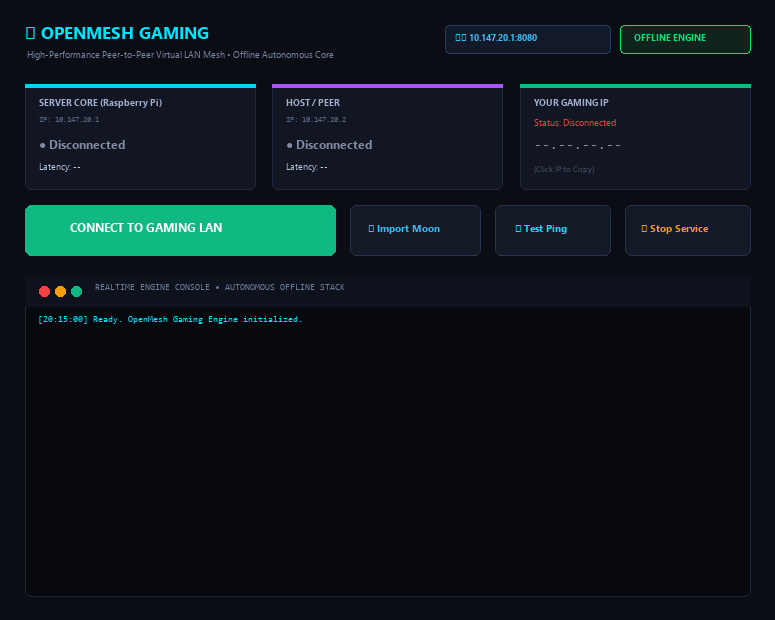

# ⚡ OpenMesh Gaming

<p align="center">
  <b>Autonomous, Self-Hosted Virtual LAN Mesh & Low-Latency Gaming Platform</b><br>
  <i>Resilient to Internet Outages • Zero Cloud Dependency • 1-Click Setup</i>
</p>

<p align="center">
  <a href="README.md"><b>English</b></a> • <a href="README.fa.md"><b>فارسی</b></a>
</p>

<p align="center">
  
  
  
  
  
</p>

<p align="center">
  
</p>

---

## 📖 Overview

**OpenMesh Gaming** is an open-source, production-ready virtual LAN mesh networking suite engineered for high-performance LAN multiplayer gaming, remote co-op, and offline peer-to-peer connectivity.

Traditional solutions (Hamachi, Radmin VPN, or ZeroTier Cloud) rely heavily on centralized cloud servers in other countries. When high ping, network congestion, or strict DPI firewalls cause disconnections, your game sessions drop.

**OpenMesh Gaming eliminates all third-party cloud dependencies**:
- Your Linux server (e.g., Raspberry Pi) acts as an **autonomous Network Controller** and a **Custom Moon Root Node**.
- Players connect directly to each other via peer-to-peer UDP hole punching.
- Local LAN traffic routes at 0–1 ms wire speed, while friends connecting over the Internet via router port forwarding experience rock-solid, direct gaming connections.

> **توضیح فارسی:**
> این پروژه یک پلتفرم گیمینگ و شبکه مش همتا‌به‌همتا (P2P) کاملاً مستقل و متن‌باز است که روی رزبری پای یا سرور لینوکس نصب می‌شود. برخلاف ردمین یا هاماچی، به هیچ سرور خارجی وابسته نیست؛ سرور و کنترلر تماماً روی سیستم خودتان اجرا می‌شود و از یک روت مستقل (Moon) استفاده می‌کند تا در شرایط اختلال اینترنت یا شبکه محلی، پینگ مینیمم و پایداری بالا فراهم شود.

---

## ✨ Features

- **🚀 1-Click Linux Installer (`install.sh`):**
  - Fully automated setup for Raspberry Pi OS, Debian, Ubuntu, and Linux Mint.
  - Provisions the ZeroTier controller daemon, assigns a configurable IP pool, creates a signed Moon root, and sets up a `systemd` background service.
  - **Fully parameterized:** mesh subnet, server virtual IP, admin credentials, dashboard port, and public IP are all configurable at install time.
- **🛡️ 100% Autonomous & Offline-Ready:**
  - Operates on isolated local offline LANs (no public internet needed).
  - Simultaneously supports remote players over the Internet via Static WAN IP or DDNS.
- **🎛️ Cyber Dark Web Management Dashboard:**
  - Modern, responsive HTML5 web interface (no Node.js or heavy frameworks required; powered by pure Python 3).
  - Real-time connected players table with IP copy buttons, ping indicators, and online status.
  - **Kick vs. Ban separation:** Kick players from the current session without banning them, or permanently Ban/Unban rule-breakers with 1 click.
  - Moon auto-regeneration modal with dual LAN/WAN endpoint coexistence.
  - Built-in router port forwarding helper.
- **🖥️ 1-Click C# Windows Client:**
  - Multi-theme support (**Cyber Dark**, **Cyberpunk Purple**, and **Clean Light**).
  - **Bilingual Interface** with instant runtime switching between **English** and **Persian (فارسی)**.
  - **Instant Cancel/Disconnect** button allowing players to abort connection handshakes at any second without freezing.
  - Real-time ping monitors for Server Core, Host/Peer, and assigned Virtual IP.
  - Auto-discovers the server across local subnets or connects via a configured public IP/domain.
  - Automatically downloads and syncs the server's signed Moon root without manual configuration.
  - Builds in seconds using the native C# compiler pre-installed on Windows (`csc.exe`).

---

## 🏗️ Architecture

```
                      +---------------------------------------+
                      |         OpenMesh Server Node          |
                      |  (Raspberry Pi / Linux Server)        |
                      |                                       |
                      |  • Embedded Controller (10.147.20.0)  |
                      |  • Custom Moon Root (Port UDP 9993)   |
                      |  • Web API & Dashboard (Port TCP 8080)|
                      +-------------------+-------------------+
                                          |
                         +----------------+----------------+
                         |                                 |
                         v                                 v
        +---------------------------------+   Direct P2P  +---------------------------------+
        |     Gaming Client PC #1         | <===========> |     Gaming Client PC #2         |
        | (Windows 10/11 - 10.147.20.101) |   (< 5ms)     | (Windows 10/11 - 10.147.20.102) |
        +---------------------------------+               +---------------------------------+
```

*For deep technical architecture details, see [docs/ARCHITECTURE.md](docs/ARCHITECTURE.md).*

---

## 🚀 Server Setup Scenarios

Choose the setup scenario that matches your deployment environment.

---

### 🏠 Scenario A: Personal Device at Home (Raspberry Pi, Mini-PC, or Home Linux PC)

Use this scenario if you are hosting the server on a hardware device connected to your home router/Wi-Fi:

* **Benefits:** Players on the same home Wi-Fi or Ethernet get wire-speed LAN routing with latency **< 1 ms**, and you retain 100% physical ownership of your hardware.
* **Requirements for Remote Internet Friends:**
  1. **Static Public IP or DDNS:** Obtain a static public IP from your ISP or use a free DDNS service (e.g., DuckDNS).
  2. **Router Port Forwarding:** Forward these two ports in your home router to your server's local LAN IP (e.g., `192.168.1.100`):
     - **`9993`** (**UDP**) ➔ ZeroTier Mesh & Moon Root Traffic
     - **`8080`** (**TCP**) ➔ Web Dashboard & Client Handshake
     *(See [docs/PORT_FORWARDING.md](docs/PORT_FORWARDING.md) for step-by-step router instructions).*
* **Installation:**
  ```bash
  git clone https://github.com/shinigami6669/OpenMesh-Gaming.git
  cd OpenMesh-Gaming/server
  sudo chmod +x *.sh
  sudo ./install.sh
  ```
  *(The installer prompts for the mesh subnet, server virtual IP, admin credentials, and — if you want Internet access — your modem's public static IP.)*

---

### ☁️ Scenario B: Cloud VPS / Dedicated Server (Hetzner, DigitalOcean, AWS, etc.)

Use this scenario if you are hosting on an internet-facing cloud virtual machine:

* **Benefits:** **Zero router configuration and zero port forwarding!** The server already has a direct public IP, 24/7 uptime, and high-speed data center bandwidth accessible by all friends from anywhere.
* **Requirements:**
  1. Simply open ports in the Linux firewall (UFW) or Cloud Security Group:
     ```bash
     sudo ufw allow 22/tcp
     sudo ufw allow 8080/tcp
     sudo ufw allow 9993/udp
     sudo ufw enable
     ```
* **Installation:**
  ```bash
  git clone https://github.com/shinigami6669/OpenMesh-Gaming.git
  cd OpenMesh-Gaming/server
  sudo chmod +x *.sh
  sudo ./install.sh
  ```
  *(Enter your VPS public IP when prompted.)*

---

### ⚙️ Server Management & 1-Click Updates

Check service status or restart:
```bash
sudo systemctl status openmesh-server
sudo systemctl restart openmesh-server
```

To update OpenMesh Server to the latest version in 1 second:
```bash
cd OpenMesh-Gaming/server
sudo ./update.sh
```

---

### 3. Windows Client Setup

<p align="center">
  
</p>

#### Option A: Build with 1-Click
No Visual Studio or external SDK required! Simply run the build script in `client/`:

```cmd
cd client
build.bat
```

The script uses Windows' built-in C# compiler (`csc.exe`) and generates `OpenMeshGaming.exe`.

#### Option B: Run and Connect
1. Launch `OpenMeshGaming.exe` (run as Administrator).
2. If connecting locally on the same Wi-Fi, the client will **auto-discover** the server.
3. If connecting from outside over the Internet:
   - Click the **`⚙️ Settings`** button in the top right.
   - Enter your host's **Public Static IP or DDNS Domain**.
   - Paste the **Bootstrap Token** printed by the installer (see below).
   - Click **Save Settings**.
4. Click **`CONNECT TO GAMING LAN`**.
5. The client downloads the server's Moon root, joins the network, and assigns your virtual gaming IP (e.g., `10.147.20.xxx`).

> **Bootstrap Token**
> The installer prints a **Bootstrap Token** and stores it in
> `server/config.json` as `bootstrap_token`. A client needs it to reach the
> server *before* it has joined the mesh — the Moon root download, the network
> ID lookup and the controller-authorization request all happen before the
> client has any mesh address, so they cannot be restricted to mesh peers
> alone. The token grants access to those three endpoints only; every other
> endpoint (the dashboard, member management, settings) still requires the
> admin username and password.
>
> Rotate it at any time by editing `bootstrap_token` in
> `server/config.json` and restarting the service.

---

## 📁 Repository Structure

```
OpenMesh-Gaming/
├── LICENSE                    # MIT License
├── README.md                  # Comprehensive Documentation (English)
├── README.fa.md               # Comprehensive Documentation (Persian)
├── .gitignore                 # Binary, credential & secret exclusions
├── docs/
│   ├── ARCHITECTURE.md        # Technical Mesh & Moon Deep Dive
│   └── PORT_FORWARDING.md     # Step-by-step Router NAT & Port Forwarding Guide
├── server/
│   ├── install.sh             # 1-Click Automated Linux Installer
│   ├── uninstall.sh           # Clean Service & Config Uninstaller
│   ├── update.sh              # In-Place Server Updater
│   ├── server.py              # Zero-Dependency Python 3 Dashboard & Web API
│   ├── config.example.json    # Example configuration file
│   └── openmesh-server.service# Systemd Unit File template
└── client/
    ├── build.bat              # Automated C# compiler batch script
    ├── config.example.json    # Client settings template
    └── src/
        ├── app.manifest       # UAC Elevation Manifest
        └── Program.cs         # Cyber Dark Windows Forms C# Client Source
```

---

## 🔒 Security & Privacy Notice

- **No Data Leakage:** This repository contains no hardcoded private keys, passwords, node IDs, or personal IP addresses.
- **No hardcoded credentials:** The dashboard password is generated or entered at install time and stored in `/opt/openmesh/config.json` — never in source code.
- **Default-password warning:** If the dashboard is started with the built-in default password, it prints a loud warning on startup. **Change it before exposing port 8080 to the Internet.**
- **Zero Cloud Tracking:** All telemetry, member lists, and network keys remain strictly on your own hardware.
- **HTTPS note:** The dashboard uses HTTP Basic Auth. For Internet exposure, put it behind a reverse proxy with TLS, or restrict access by VPN/firewall.

---

## 📜 License

This project is licensed under the **MIT License** - see the [LICENSE](LICENSE) file for details.

## Scripting the client (control channel)

The Windows client exposes a small HTTP control channel on `127.0.0.1:17871`
so it can be driven by scripts instead of by hand. It binds to loopback
only, and every request has to carry the shared token, so nothing outside
the machine can reach it.

The token is created on first launch and stored at:

```
%AppData%\OpenMeshGaming\control_token.txt
```

Two ready-made helpers ship with the client:

```
control\omc.sh      # bash / Git-Bash
control\omc.ps1     # PowerShell
```

```bash
./control/omc.sh status              # state as JSON
./control/omc.sh log                 # the recent client log
./control/omc.sh connect             # join the gaming LAN
./control/omc.sh disconnect          # leave the gaming LAN
./control/omc.sh cancel              # cancel a connection attempt in flight
./control/omc.sh ping                # run a manual ping
./control/omc.sh service             # toggle the ZeroTier service
./control/omc.sh settings server=192.168.31.96 port=8080 token=XXXX
./control/omc.sh quit                # close the client
```

```powershell
.\control\omc.ps1 status
.\control\omc.ps1 connect
.\control\omc.ps1 log
```

### Raw HTTP

```
GET  /status       current state as JSON
GET  /log          the recent client log
GET  /token        the control token
POST /connect      start the connect flow
POST /disconnect   disconnect
POST /cancel       cancel an in-flight connect
POST /ping         run a manual ping
POST /service      start/stop the ZeroTier service
POST /settings     set server address / port / bootstrap token, then save
POST /quit         close the client
```

Pass the token in the `X-OpenMesh-Control` header, as
`Authorization: Bearer <token>`, or as a `?token=` query parameter.

```bash
TOKEN=$(cat "$APPDATA/OpenMeshGaming/control_token.txt")
curl -s -H "X-OpenMesh-Control: $TOKEN" http://127.0.0.1:17871/status
```

The port can be changed with the `OPENMESH_CONTROL_PORT` environment
variable.

